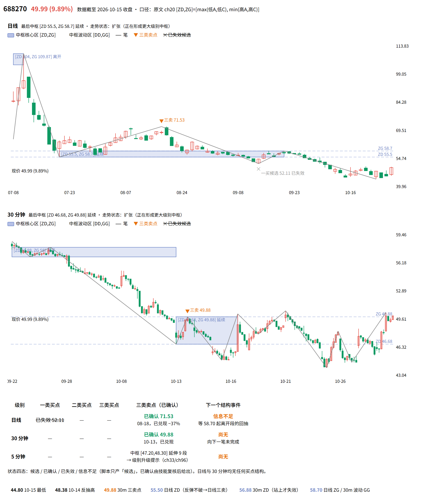

# 缠论盯盘 Bot

一个自托管的 A 股缠论结构盯盘机器人：**通达信自选股 → 实时行情 → 分型/笔/中枢/MACD → 三类买卖点候选 → 10 个缠论技能逐条复核 → 推送到手机**。

[](LICENSE)
[](https://www.python.org/)
[](#依赖)
[](https://hermes-agent.nousresearch.com/docs)



*真实输出，不是示意图：`python agent/chan_chart.py 688270` 一条命令生成的双周期结构图——日线 + 30m 各画笔、中枢方框（`[ZD, ZG]` 核心区与 `[DD, GG]` 波动区）、三类买卖点标记、底部结论表。*

## 目录

- [免责声明](#免责声明)
- [它长什么样](#它长什么样)
- [特性](#特性)
- [工作原理](#工作原理)
- [快速开始](#快速开始)
- [安装](#安装)
- [用法](#用法)
- [配置](#配置)
- [常见问题](#常见问题)
- [已知限制](#已知限制)
- [目录结构](#目录结构)
- [几个工程取舍](#几个工程取舍)
- [许可](#许可)

## 免责声明

⚠️ **先读这四条，再决定要不要往下看。**

- **这不是荐股工具。** 它输出的是「结构判断 + 成立/失效条件」，不是「现在买入/卖出」。
- **不承诺盈利。** 缠论原文里的「必然」是结构意义上的结论，**不含** T+1、滑点、涨跌停、流动性约束。
- 所有判断都可能错，而且经常错。下单的决定权和后果都在你自己手上。
- 作者不对任何交易结果负责。仅供个人研究与技术学习，**不构成投资建议**。先看两周、先小仓位，再决定要不要让它进你的流程。

## 它长什么样

真实推送节选（2026-10-27 收盘全览，688270 一票）：

```markdown
### 688270　收 45.49（+2.09%，高 48.49、低 45.37）
**①走势类型**：30m「下跌趋势 + 中枢延续」。中枢 zs[2] 56.88–58.00 与当前中枢 zs[3] 46.68–49.88
核心区不相交、同向向下，新趋势成立；当下是 zs[3] 的向下离开段反抽失败后再回落。
**②中枢**：第 4 个，**[ZD 46.68，ZG 49.88]**，波动区 [DD 43.92，GG 50.58]，seg 8 / ext 5
→ 仍是 30m 级别（未到 9 段）。
**③买卖点**：
- 一买 **43.92（10-23 11:00）＝候选（级别二义）**：C/A=0.72，43.92 破前低 44.80，三前提①②③全过；
  但 zs[2] 的 DD 46.68 与 zs[3] 的 ZD 46.68 完全重合 → 「下跌趋势」与「中枢扩张」两解都合法，
  级别名称不确认。
- 二买 **44.55（10-26 14:00）＝候选**：回试未破 43.92；但位置在中枢之下 → 按 ch21 力度可疑。
- 三买：不存在。
**④明日盯**：成立——守住 44.55、5m 出底背驰或双次回拉不破 45.37、再站上 46.68 → 可升级；
失效——有效跌破 44.55 → 二买失效，回试 43.92；再破则一买证伪。
**⑤三情景**：①弱反弹 ②中枢扩张 ③反趋势（需 30m 向上笔站上 49.88 且回试不回中枢，现不成立）。
```

几个刻意的写法：**级别二义就说二义**、**候选不许写成已确认**、**每条都给失效条件**、**结尾永远是非投资建议**。

## 特性

- **只用结构说话**：分型 → 笔 → 中枢（ZD/ZG）→ MACD 力度 → 三类买卖点，判定链完全可复盘。
- **四态状态机**：`候选 / 已确认 / 已失效 / 信息不足`。判断不了写「信息不足」，不为凑结论而编。
- **自选股跟着客户端走**：直接读通达信 `T0002/blocknew/zxg.blk`，客户端里加票，下一轮自动带上。
- **wake gate 省 token**：没有新信号时脚本输出 `{"wakeAgent": false}`，cron 直接跳过——不唤醒模型、不投递、零成本。盘中 9 轮里绝大多数走这条路径。
- **进展复推**：同一信号不刷屏，但价格变动 1.5% 或超过 60 分钟，会以「进展」形式再推一次。
- **去重持久化**：键 = `代码|类型|端点时间|状态`，存 `state/seen.json`，重启不丢。
- **门闸纪律**：`trading=false` / 自选股空 / 全采集失败 → 直接 `[SILENT]`，不产生噪音。
- **一条命令出图**：`chan_chart.py` 生成自包含 HTML（结构图 + 结论表），截图即封面。

## 工作原理

```
cron（15:05 收盘 / 交易时段每半小时）
  │  cron/scripts/chanlun_close.sh            ← 只做一层转发
  ▼
agent/run_close.sh ──► tdx 的 python ──► agent/chanlun_prep.py
                                          │ 读通达信自选股
                                          │ tdxlive 取 30m/5m/1m/day K 线
                                          │ chan_structure.py 算分型/笔/中枢/背驰
                                          ▼
                                stdout 精简 JSON（候选 + 大盘背景）
                                          │  没有候选 → {"wakeAgent": false} → 到此为止
                                          ▼
                            Hermes agent（SOUL.md + 10 个缠论技能）
                                          │  逐只复核，四选一给状态
                                          ▼
                                 out/decide_*.json
                                          ▼
                     agent/push_signals.py ──► ClawChat 私聊 / 飞书机器人
```

脚本干「算」，模型干「判」，两者用一份 JSON 契约连起来——这就是这个 bot 的全部设计。

## 快速开始

三步验证链路通不通（不改任何代码）：

```bash
git clone <你的仓库地址> chanlun-bot && cd chanlun-bot
python -m venv .venv && .venv/Scripts/python.exe -m pip install -r tdx/requirements.txt
.venv/Scripts/python.exe tdx/watch.py scan          # ① 行情主站能不能连
```

```bash
# ② 读自选股 + 算结构（非交易时段加 --force 取上一交易日数据）
TDX_PY="$PWD/.venv/Scripts/python.exe" bash agent/run_scan.sh intraday --force
# 看到 {"trading": true, "stocks": [...]} 就成了

# ③ 出结构图（自己看，不需要模型）
.venv/Scripts/python.exe agent/chan_chart.py 688270
# written: agent/out/688270_chan.html —— 用浏览器打开
```

想接成「自动推送」的完整形态，看 **[docs/快速上手.md](docs/快速上手.md)**（面向没碰过 Python 的分步版）和 **[cron/README.md](cron/README.md)**（两个定时任务怎么建）。

## 安装

### 依赖

| 依赖 | 说明 |
|---|---|
| Windows + 通达信 PC 客户端（64 位） | 行情与自选股都从本地客户端读。默认 `C:\new_tdx64`，用 `TDX_DIR` 覆盖 |
| Python 3.10+（实测 3.14） | 独立 venv：`pytdx` `mootdx` `pandas` `numpy` |
| [Hermes Agent](https://hermes-agent.nousresearch.com/docs) | 提供 cron、技能、模型调用、ClawChat 投递 |
| ClawChat（可选） | 推送通道；不要就改 `agent/config.json` 的 `push.channel` 或自己实现 |

> Linux / macOS 也能跑结构算法，但行情层 `tdx/tdxlive.py` 依赖通达信客户端文件，需要自己换数据源——它是唯一耦合点。

### 1. 装依赖

```bash
python -m venv .venv
.venv/Scripts/python.exe -m pip install -r tdx/requirements.txt
```

### 2. 装技能

12 个技能（10 个缠论 + `chanlun-live-scan` 总调度 + `tdx-realtime-quotes`）：

```bash
cp -r skills/finance/* "$HERMES_HOME/profiles/<profile>/skills/finance/"
# 或用全局：cp -r skills/finance/* ~/.hermes/skills/finance/
```

### 3. 装人格与配置

- `SOUL.md` → 放到 profile 根目录（`$HERMES_HOME/profiles/<profile>/SOUL.md`）。它定义了这个 bot 是谁、能做什么、绝不做什么。
- `config/hermes-profile.example.yaml` → 把 `model` / `platforms.clawchat` / `cron` 三块按同名键合并进 profile 的 `config.yaml`。
- `platforms.clawchat.extra` 里的 `user_id` / `agent_id` / `owner_user_id` 是每个 agent 独有的，**激活新 agent 时由客户端写入，别抄别人的**。

### 4. 配推送

```bash
cp .env.example .env      # 只有用飞书才需要填；.env 已被 .gitignore 排除
```

走 ClawChat 时只需把 `agent/config.json` 里 `push.clawchat.profile`（profile 名）和 `hermes_home`（Hermes 根目录）填对，然后自检：

```bash
hermes -p <profile> send --to clawchat "通道自检：缠论盯盘"
```

### 5. 建定时任务

见 **[cron/README.md](cron/README.md)**。两个任务：`收盘全览`（15:05，每天必推）和 `盘中扫描`（每半小时，只在新信号/进展时推）。建议盘中那个先 `--paused`，确认收盘全览稳定后再放开。

## 用法

### 手动跑一轮

```bash
bash agent/run_scan.sh intraday             # 盘中；交易时段外返回 trading:false
bash agent/run_scan.sh intraday --force     # 调试：非交易时段也采集
bash agent/run_scan.sh intraday --wake-gate # cron 用的形式：无信号时末行追加 {"wakeAgent": false}
bash agent/run_close.sh                     # 收盘全览数据
```

`run_scan.sh` 用 `TDX_PY` 指定解释器（默认 `E:/Hermes/tdx-live/.venv/Scripts/python.exe`）；`cron/scripts/*.sh` 用 `CHANLUN_AGENT` 指定引擎目录。

### 推一条消息

```bash
cat > agent/out/decide_1505.json <<'EOF'
{"title":"缠论盯盘 15:05","summary":"上证 30m 仍在第 3 个中枢内震荡",
 "approve":[{"code":"600089","type":"三类买点","note":"失效条件：跌回 17.43"}],
 "reject":[{"code":"002555","type":"二类买点","reason":"一买未过背驰三前提"}],
 "footer":"非投资建议；仅结构判断"}
EOF

cd agent && "$TDX_PY" push_signals.py --prep-latest --decide out/decide_1505.json
# 返回 {"ok":true,"sent":true} 才算成功
```

### 相关性与结构互证

```bash
"$TDX_PY" skills/finance/chanlun-live-scan/scripts/corr_probe.py 001270 688270
# 票间日收益相关系数（20/40/60/全样本）+ 结构同步度；--ref 999999 换对照指数
```

## 配置

`agent/config.json` 里值得改的几项：

| 键 | 默认 | 作用 |
|---|---|---|
| `watchlist_source` | `tdx_zxg` | 自选股来源。`tdx_zxg` = 实时读通达信 `zxg.blk` |
| `exclude_codes` | `[]` | 不想看的代码（比如长期停牌的） |
| `levels` | `{main:30m, sub:5m, micro:1m, trend:day}` | 四级周期 |
| `bars_count` | `{30m:320, 5m:240, 1m:240, day:250}` | 各周期取多少根；不够时会报「K线 N 根」 |
| `progress.min_interval_min` | `60` | 同一信号多久可以复推一次 |
| `progress.price_change_pct` | `1.5` | 价格变动多少算「进展」 |
| `push.channel` | `clawchat` | `clawchat` / `feishu` |
| `push.min_state` | `["候选","已确认"]` | 只有这两个状态会推 |

## 常见问题

**Q：跑出来 `trading: false`？**
不是 bug。非交易时段 / 周末 / 非交易日（按上证日线最后更新日期判断）。调试加 `--force`。

**Q：`自选股为空`？**
`TDX_DIR` 指错了，或客户端里真没票。默认读 `C:\new_tdx64\T0002\blocknew\zxg.blk`。

**Q：`30m 结构不足（K线 N 根）`？**
主站没给够 K 线。先 `python tdx/watch.py scan` 看主站可用性，再调大 `bars_count`。

**Q：返回 `{"ok": true}` 但手机没收到？**
看 `$HERMES_HOME/profiles/<profile>/logs/*.log` 里的 `standalone send ok` + `ack_received`。只有连接处于 `state=ready` 时才能发出去。

**Q：为什么每只票都要强调「第几个中枢」「seg/ext」？**
`seg < 9` 是标准中枢，`seg ≥ 9` 意味着中枢扩张、级别升级。同一价位在不同级别下结论可能相反，所以级别必须先确认。

**Q：能赚钱吗？**
不知道。它只负责把「结构是什么、成立条件是什么、什么情况下失效」讲清楚。赚钱与否取决于你怎么用它——以及市场。任何声称必然盈利的缠论工具都在骗你。

更多排障见 **[docs/FAQ.md](docs/FAQ.md)**。

## 已知限制

- 只能跑 Windows + 通达信客户端（行情层耦合）。
- `pytdx` / `mootdx` 在线行情在部分网络环境会失效，换主站是老办法。
- 结构算法是「原文口径的可执行近似」：用**笔**代替次级别走势类型构中枢，算的是**本级别中枢**；边界情形（段被破坏、扩展中枢、多义性）最终仍需人看。
- 级别二义不会被强行消解——脚本只给候选，二义就标二义。
- **没有回测**。这个仓库只做「当下结构判定」，不做收益曲线。

## 目录结构

```
SOUL.md                        bot 的人格与纪律（是谁、能做什么、绝不做什么）
agent/                         引擎：结构算法 + 采集 + 推送
  chan_structure.py            分型/笔/中枢/MACD/三类买卖点
  chanlun_prep.py              采集 + 结构 + 候选 → 精简 JSON（stdout 喂给模型）
  chan_chart.py                单只标的双周期结构图 → 自包含 HTML
  push_signals.py              组装正文并按通道投递
  push.py                      飞书通道（默认停用）
  run_scan.sh / run_close.sh   本地入口
  config.json                  级别、K线根数、并发、推送通道
tdx/                           行情层：tdxlive.py / watch.py / verify.py
skills/finance/                12 个技能：10 个缠论 + 总调度 + 实时行情
cron/                          两个定时任务的转发脚本、真 prompt、建法
config/                        Hermes profile 配置示例
docs/                          快速上手、FAQ、截图
memories/                      记忆文件模板
.env.example                   推送凭据模板
```

## 几个工程取舍

这些是踩过坑才有的设计，改代码前值得先读：

| 取舍 | 原因 |
|---|---|
| **wake gate** | 没信号时唤醒模型纯烧钱（实测每轮约 3.7 万 token）。脚本先判，无候选直接掐掉整轮 |
| **笔近似次级别走势段** | 用本级别「笔」代替「次级别走势类型」构中枢，算的是**本级别中枢**。引用时必须说清这个近似 |
| **中枢退化过滤** | 三段重叠宽度 < 价格 × 0.25% 不算中枢，否则会出 `[17.16, 17.17]` 这种宽 1 分钱的假中枢 |
| **中枢区间锁原文口径** | `[ZD, ZG] = [max(低_A, 低_C), min(高_A, 高_C)]`（A、C 为与中枢形成方向一致的前两个段）。**不要**换成「所有段重叠」口径当三买卖点基准——口径不同、公式不同，不可互换 |
| **候选 ≠ 已确认** | 「已确认」只表示回试后又走了一段；回试是否真结束，要看 5m/1m 的背驰或双次回拉 |
| **指数只作背景** | `is_index: true`（如 `999999`）不出可执行买卖点，只给涨跌家数 |

## 许可

MIT，见 [LICENSE](LICENSE)。缠论原文的著作权归原作者；本仓库只包含对原文的工程化实现与解读笔记。

本项目由 AI 辅助开发与打包。遇到问题请开 Issue。